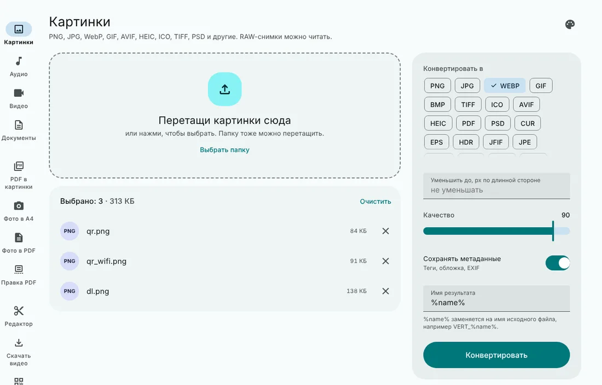
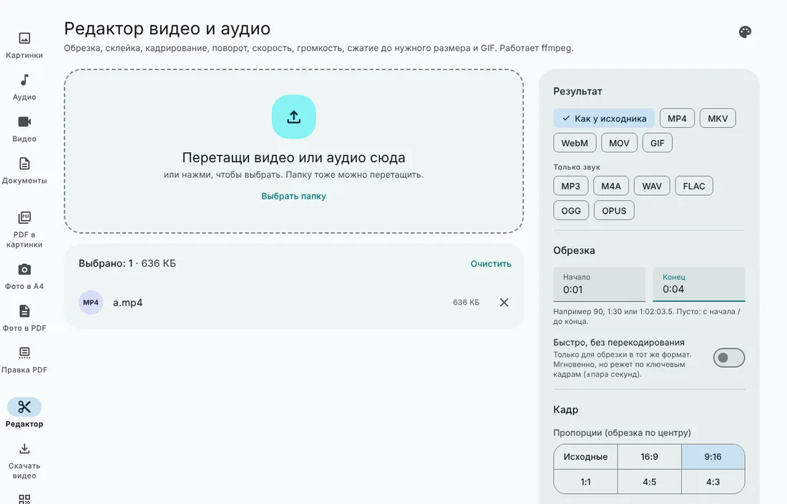
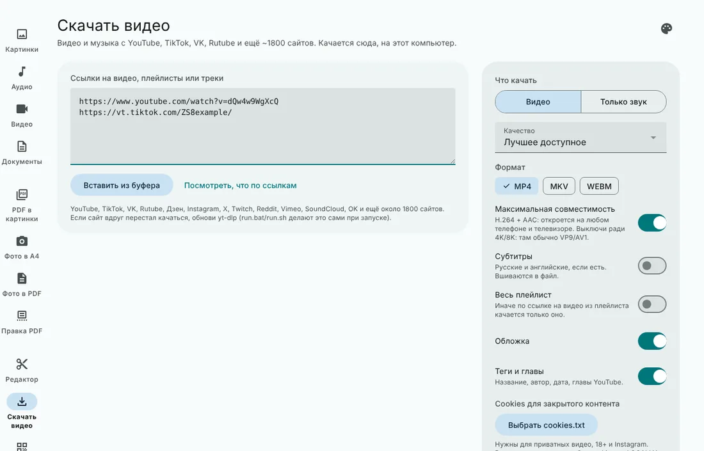
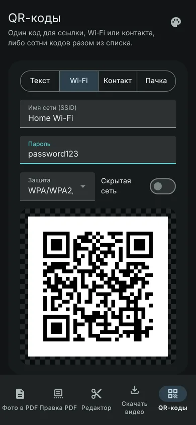
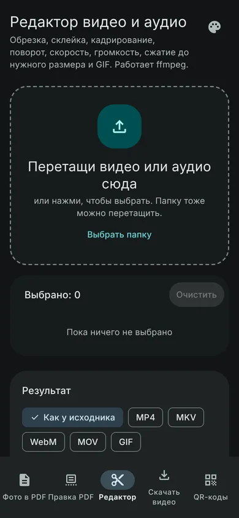

# Universal

[](https://github.com/Zaxar1231/Universal-app/actions/workflows/tests.yml)
[](https://zaxar1231.github.io/Universal-app/)
[](https://github.com/Zaxar1231/Universal-app/releases/latest)
[](LICENSE)

**[Открыть сайт →](https://zaxar1231.github.io/Universal-app/)**: QR-коды, конвертер картинок и правка PDF работают прямо в браузере, в том числе на телефоне. Видео, аудио и скачивание требуют полной версии (ниже).



Локальный комбайн для файлов: конвертер форматов (как vert.sh), редактор видео и аудио на ffmpeg, скачивание видео с любых сайтов и QR-коды. Всё работает на твоём компьютере или домашнем сервере, файлы никуда не уходят (кроме скачивания, понятно).

## Режимы
| Режим | Что делает | Нужно |
|---|---|---|
| Картинки | PNG, JPG, WebP, GIF, AVIF, HEIC, ICO, TIFF, PSD, RAW и другие; можно сразу уменьшить до N px | ImageMagick |
| Аудио | MP3, WAV, FLAC, OGG, Opus, AAC, M4A и другие, а также аудио в видео | ffmpeg |
| Видео | MP4, MKV, WebM, AVI, MOV и другие, а также звук из видео | ffmpeg |
| Документы | DOCX, DOC, MD, HTML, RTF, EPUB, ODT, CSV и другие | pandoc (+ LibreOffice для .doc) |
| PDF в картинки | JPG, PNG, TIFF, WebP, SVG, PS, EPS | poppler |
| Фото в A4 | фото приводятся к листу A4 с нужным DPI | Pillow |
| Фото в PDF | 1, 2, 4, 6, 8 или 9 фото на лист A4 | Pillow |
| **Правка PDF** | склеить, разделить по страницам, вытащить страницы (1-3, 5, 8-), повернуть, сжать сканы, поставить или снять пароль | pypdf (ставится сам) |
| **Редактор PDF** | текст, перо, маркер, рамка, «замазать», картинка, подпись; переставить, повернуть, удалить страницы, пустой лист, добавить страницы из другого PDF; «сплющить в картинки», чтобы замазанное исчезло по-настоящему | ничего (pdf.js и pdf-lib встроены) |
| **Фоторедактор** | обрезка с пропорциями (1:1, 4:3, 16:9, 9:16…), поворот, отражение, размер, яркость, контраст, насыщенность, тепло, ч/б, сепия, виньетка, размытие, готовые фильтры, надпись и водяной знак, отмена шагов; HEIC/TIFF/PSD/RAW открываются через ImageMagick; сохранение в JPG/PNG/WebP без EXIF | ничего (ImageMagick для HEIC/RAW) |
| **Редактор документов** | как Word: шрифты, заголовки, списки, таблицы, картинки, цвета, ссылки, поиск, печать; открывает DOCX, DOC, ODT, RTF, HTML, Markdown, TXT, сохраняет в DOCX, ODT, RTF, PDF, HTML, MD, TXT; черновик сохраняется сам | LibreOffice (или pandoc; PDF только через LibreOffice) |
| **Архивы и файлы** | упаковать в ZIP или 7z (с паролем AES-256), распаковать ZIP/7z/TAR/GZ/BZ2/XZ с папками (русские имена из Windows-архивов читаются правильно), контрольные суммы MD5/SHA-1/SHA-256/SHA-512 (файлы для `sha256sum -c`), переименовать пачкой по шаблону | py7zr для 7z |
| **Голос в текст** | голосовые Telegram/WhatsApp (OGG, Opus), MP3, M4A, WAV, видео → текст и субтитры .srt; модель Whisper на компьютере, без интернета после первой загрузки; с телефона — через свой компьютер | faster-whisper (встроен в сборки для Windows и macOS) |
| **Распознать текст** | сканы PDF и фото документов → PDF, в котором можно искать и копировать текст ([OCRmyPDF](https://github.com/ocrmypdf/OCRmyPDF)); русский, английский и другие языки, выравнивание перекошенных и поворот перевёрнутых страниц, архивный PDF/A, текст в .txt | OCRmyPDF, Tesseract (на Windows ставится кнопкой) |
| **Редактор** | обрезка, склейка, кадрирование 9:16/1:1/…, поворот, разрешение, fps, скорость 0.25–4×, громкость, нормализация, появление/затухание, без звука, сжатие до N МБ, H.264/H.265/VP9/AV1, видео в GIF, предпросмотр с выбором начала и конца | ffmpeg |
| **В Markdown** | PDF, сканы и картинки, Word, PowerPoint, Excel, EPUB, HTML превращаются в чистый Markdown: заголовки, списки, таблицы (в точном режиме и формулы в LaTeX); картинки отдельными файлами. Быстрый режим и точный; движок ставится по кнопке и всё считает на компьютере | MinerU (ставится по запросу) |
| **Читалка** | любой текст сворачивается по уровням: от карты на один экран до каждого слова. Читаешь оригинал, а не пересказ. Принимает ссылки, PDF, Word, Excel, EPUB, текст и голосовые после распознавания; модель для сворачивания подключаешь сам (Claude Code, Codex, свой ключ API или локальная Ollama) | TextFold (вшит) |
| **Скачать видео** | YouTube, TikTok, VK, Rutube, Instagram, X, Twitch, SoundCloud и ~1800 сайтов; видео до 4K или только звук (MP3/M4A/Opus/FLAC/WAV), плейлисты, субтитры, обложки, cookies для закрытого | yt-dlp, ffmpeg, deno для YouTube |
| **Сохранить страницу сайта** | любая страница одним HTML-файлом: стили, картинки и шрифты внутри, открывается без интернета; без скриптов и рекламы, cookies для закрытых страниц; работает и на Android | monolith (скачивается сам) или встроенный сохранитель |
| **QR-коды** | текст/ссылка, Wi‑Fi, контакт (vCard) с живым предпросмотром; пачка из списка, .txt, .csv или .docx; PNG/SVG/JPG, цвета, прозрачный фон; **QR вместо ссылок прямо в документе** (Word, Markdown, HTML, ODT, RTF, DOC, EPUB) с выбором ссылок галочками | qrcode |

Конвертер, редактор, скачивание и правка PDF идут в фоне: видно проценты, их можно отменить.

<p>


</p>
<p>


</p>

## Установка
Все файлы в [последнем релизе](https://github.com/Zaxar1231/Universal-app/releases/latest).

| Система | Файл | Как поставить |
|---|---|---|
| Windows 10/11 | `Universal-Setup-X.Y.Z.exe` | запустить установщик. Движки приложение предложит скачать одной кнопкой |
| Windows без установки | `Universal-X.Y.Z-windows-portable.zip` | распаковать, запустить `Universal.exe` |
| Debian, Ubuntu, Mint | `universal_X.Y.Z_all.deb` | `sudo apt install ./universal_X.Y.Z_all.deb` |
| Fedora | `universal-X.Y.Z-1.noarch.rpm` | `sudo dnf install ./universal-X.Y.Z-1.noarch.rpm` |
| Arch, Manjaro | `universal-X.Y.Z-1-any.pkg.tar.zst` | `sudo pacman -U universal-X.Y.Z-1-any.pkg.tar.zst` |
| macOS (Apple Silicon / Intel) | `Universal-X.Y.Z-macos-arm64.dmg` / `-x86_64.dmg` | открыть, перетащить в «Программы»; движки: `brew install ffmpeg imagemagick pandoc poppler` |

На Linux ffmpeg, ImageMagick, pandoc и poppler приходят зависимостями пакета. В Fedora основной ffmpeg (`ffmpeg-free`) не умеет H.264/H.265: для редактора видео поставь ffmpeg из [RPM Fusion](https://rpmfusion.org/).

Первый запуск на macOS: приложение не подписано сертификатом Apple, поэтому открой его правой кнопкой → «Открыть» (или «Системные настройки → Конфиденциальность и безопасность → Всё равно открыть»). На Windows SmartScreen может попросить «Подробнее → Выполнить в любом случае».

## Установка из исходников (Windows, Linux, macOS)
1. Python 3.10 или новее (на Windows отметь Add Python to PATH).
2. Программы (ставь те, что нужны твоим режимам):
   - Windows: `choco install ffmpeg imagemagick pandoc poppler libreoffice-fresh`
   - Debian/Ubuntu: `sudo apt install ffmpeg imagemagick pandoc poppler-utils libreoffice tesseract-ocr-rus`
   - macOS: `brew install ffmpeg imagemagick pandoc poppler tesseract tesseract-lang`
3. Скачай код: `git clone https://github.com/Zaxar1231/Universal-app` (или Code → Download ZIP на GitHub) и распакуй.
4. Запуск: Windows `run.bat`, Linux/macOS `./run.sh`. Скрипты сами создадут окружение, доставят новые зависимости после обновления и каждый раз обновят yt-dlp.
5. Открой http://localhost:5000

Если нужной программы нет, интерфейс покажет красный баннер в соответствующем режиме.

## Приложение для Android и iPhone
В каждом релизе лежат `Universal-X.Y.Z-android.apk` и `Universal-X.Y.Z-ios-unsigned.ipa`. Внутри:
- **Скачать**: ссылки на видео (или «Поделиться → Universal» из YouTube, TikTok, браузера на Android) качаются прямо на телефон. Качает yt-dlp на твоём сервере Universal (компьютер или Docker, с его VPN), а готовый файл сам приезжает на телефон.
- **Инструменты**: на Android — **полная версия Universal прямо в телефоне**, без компьютера: конвертер картинок, аудио, видео и документов, видеоредактор, PDF, распознавание текста, голос в текст, QR и архивы (нужен 64-битный телефон). На iPhone — QR-коды, картинки и PDF, как на сайте.
- **Файлы**: всё скачанное и сохранённое (Android: папка «Документы/Universal», iPhone: «Файлы → На iPhone → Universal»), кнопка «Поделиться» отправит в галерею, Telegram и куда угодно.
- **Сервер**: подключение к Universal на компьютере по QR-коду, проверка и вход в полную версию.

Установка на Android: скачай APK на телефон и открой, разреши установку из этого источника. На iPhone без аккаунта разработчика Apple IPA ставится через [AltStore](https://altstore.io) или [Sideloadly](https://sideloadly.io) (подпись на 7 дней, они продлевают её сами). Подробности и сборка: [`mobile/README.md`](mobile/README.md).

## Обновления
Приложение само проверяет новые версии на GitHub (раз в несколько часов) и показывает баннер «Обновить». На Windows обновление ставится и перезапускает приложение само, на macOS и Linux скачивается и открывается нужный файл. Вручную: значок палитры → «Проверить обновления». На Android новый APK скачивается и открывается установка прямо из приложения.

## Сервер для телефона
В приложении на компьютере нажми значок телефона вверху справа и включи «Открыть сервер для мобильного приложения». Появятся адрес, пароль (придумывается сам) и QR-код. В приложении на телефоне: вкладка «Сервер» → «Сканировать QR-код», и всё. Docker не нужен, сервер включается сам при следующих запусках. Телефон и компьютер должны быть в одной Wi‑Fi сети; Windows может один раз спросить про брандмауэр — разреши для частной сети. Через этот сервер пароль нужен всегда, а выключить его или сменить пароль можно только с самого компьютера.

## Открыть с телефона в браузере
Телефон и компьютер в одной Wi‑Fi сети. Запусти сервер открытым в сеть и с паролем:
```bash
HOST=0.0.0.0 APP_PASSWORD=мой-пароль ./run.sh                 # Linux / macOS
set HOST=0.0.0.0&& set APP_PASSWORD=мой-пароль&& run.bat      # Windows (cmd)
```
Потом на телефоне открой `http://IP-компьютера:5000` (IP смотри в `ipconfig` / `ip a`), логин любой. Windows спросит про брандмауэр: разреши для частной сети.

## Docker (домашний сервер)
```bash
docker compose up -d --build
```
Внутри уже есть ffmpeg, ImageMagick, pandoc, poppler и LibreOffice. Поменяй `APP_PASSWORD` в `docker-compose.yml`. Обновить yt-dlp: `docker compose build --no-cache && docker compose up -d`.

## Настройки (переменные окружения)
| Переменная | По умолчанию | Зачем |
|---|---|---|
| `HOST` | `127.0.0.1` | `0.0.0.0`, чтобы пускать из сети |
| `PORT` | `5000` | порт |
| `APP_PASSWORD` | пусто | пароль на вход (браузер спросит, логин любой) |
| `WORK_DIR` | временная папка | где лежат задания; результаты удаляются через час |
| `TASK_WORKERS` | `2` | сколько тяжёлых задач идёт одновременно |

## Тесты
```bash
pip install pytest
python -m pytest -q          # на роликах, которые генерирует ffmpeg
NET=1 python -m pytest -q    # плюс настоящее скачивание с YouTube
```

## Консольный QR
`tools/bulk_qr.py` — исходный скрипт массовой генерации, работает и без сервера: `python tools/bulk_qr.py links.docx -f svg`.

## Сайт
Папка `site/` публикуется на GitHub Pages workflow-ом `.github/workflows/pages.yml` при каждом пуше в `main`. Это статическая страница: QR (qrcode-generator), картинки (canvas) и PDF (pdf-lib) работают в браузере, её можно установить на телефон как приложение и пользоваться офлайн.

## Сборка настольных версий
Linux-пакеты собирает `packaging/linux/build.sh` (дерево `/usr` + `.deb`), `build-rpm.sh` и `build-arch.sh` в контейнерах Fedora и Arch; чистые Python-библиотеки лежат внутри пакета, Pillow, cryptography и WebKitGTK берутся системные. macOS: тот же `packaging/universal.spec` собирает `Universal.app`, `hdiutil` делает `.dmg`. Каждый пакет в workflow «Релиз» ставится в чистый контейнер своего дистрибутива (Debian 12, Ubuntu 22.04/24.04, Fedora, Arch) и проходит `universal --smoke`.

Windows: `desktop.py` запускает тот же сервер внутри окна pywebview, `engines.py` качает движки в `%LOCALAPPDATA%\Universal\engines`. Exe собирает PyInstaller (`packaging/universal.spec`), установщик Inno Setup (`packaging/installer.iss`); всё это делает workflow «Релиз» на Windows-раннере и перед публикацией запускает `Universal.exe --smoke`. Локально: `pip install -r packaging/requirements-desktop.txt && python desktop.py`.

## Автомерж
PR из веток `claude/…` сливаются в `main` сами (workflow «Автомерж»), когда на последнем коммите все проверки зелёные. Черновики, PR с красными проверками и с конфликтами не сливаются. После слияния он же обновляет сайт на GitHub Pages.

## Релизы
Описание версий в `CHANGELOG.md`. Новый релиз: добавь раздел `## vX.Y.Z` в CHANGELOG и запусти workflow «Релиз» (Actions → Релиз → Run workflow) или запушь тег `vX.Y.Z`. Файлы и описание соберутся сами. В релизе только приложения: установщик и портативная версия для Windows, пакеты для Linux и macOS, APK для Android и IPA для iPhone. Запуск из исходников, Docker и сайт — из репозитория (`git clone`).

## Лицензии
Проект под AGPL-3.0 (см. `LICENSE`): набор форматов и логика параметров звука/видео в конвертере взяты из проекта VERT (AGPL-3.0). yt-dlp — Unlicense, monolith — CC0, TextFold — Apache-2.0 (вшит в `third_party/textfold`, лицензия и NOTICE рядом), MinerU — Apache-2.0 с дополнительными условиями (в приложение не входит, ставится по запросу в отдельную папку). Скачивай только то, на что у тебя есть права.

Подробности устройства: `HANDOVER.md`.
